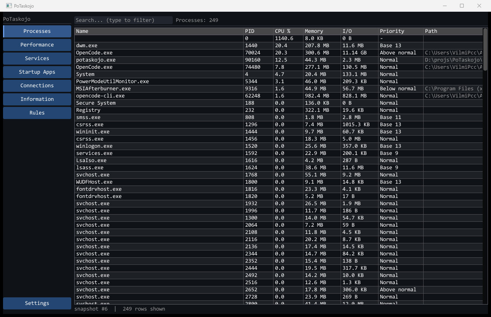
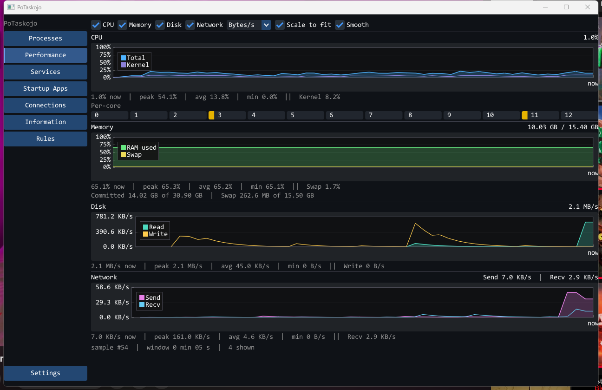
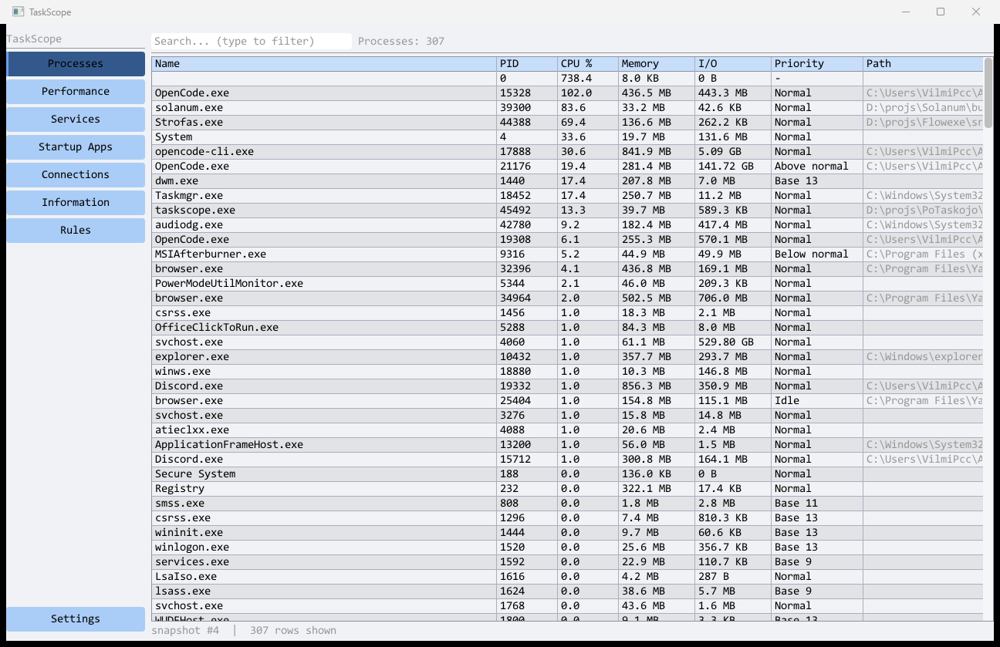
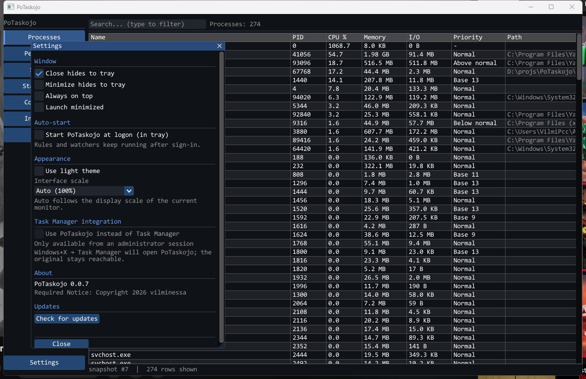
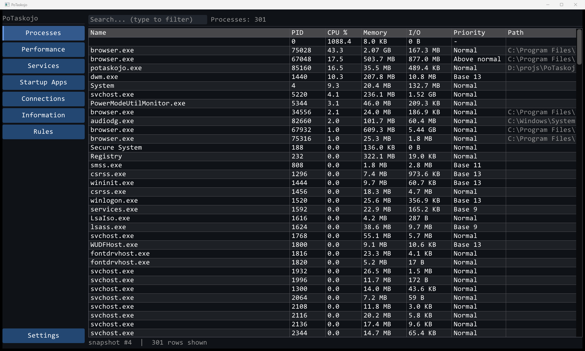

# PoTaskojo

A native system monitor for Windows built in C++: processes, performance,
services, startup programs, connections, system information and per-program
rules, all in one resizable window with a tray icon.

No installer, no background service, no telemetry — one executable.



## What is inside

**Processes** — one `NtQuerySystemInformation` call refreshes the whole table:
CPU, memory, I/O, priority and path for every process. Sort any column, filter
as you type, right-click to end/suspend/resume, change priority, open the file
location or copy the path. Windows-critical and protected processes are refused.

**Performance** — live plots for CPU (total and kernel), memory and swap, disk
read/write and network send/receive, each with a legend, an axis with units and
a now/peak/avg/min readout, plus a per-core activity strip. A toolbar toggles
charts, switches bytes/bits and turns auto-scaling and smoothing on or off.

**Services** — enumerate the SCM, see display name, state, start type and PID,
then start, stop, pause, resume or restart (administrator required).

**Startup apps** — current-user and local-machine `Run` keys (including the
32-bit view) plus both startup folders, with the `StartupApproved` state, so
entries can be enabled, disabled or deleted.

**Connections** — TCP and UDP, IPv4 and IPv6, resolved to the owning process
through `GetExtendedTcpTable` / `GetExtendedUdpTable`.

**Information** — OS build, uptime, memory, processor and elevation.

**Rules** — give a program a priority (including *Efficiency mode*) and a
behaviour on launch. Rules apply to every matching process instance, so
newly started copies are not missed, persist in a versioned file, and are
guarded by automatic breakers that pause them if too many actions fire within
a minute.

**Shell integration** — tray icon with close/minimize-to-tray, start at logon,
dark and light themes, and an optional *Replace Task Manager* toggle that
routes `Win+X → Task Manager` to PoTaskojo through Image File Execution
Options (the real Task Manager stays reachable).

**Resilience** — an unhandled exception writes `logs\crash-report.log` and a
minidump before the process exits, and a low-memory watcher reacts when free
memory drops below the threshold.

## Screenshots

| Performance charts | Light theme |
| --- | --- |
|  |  |

| Settings | Scaled to 150% |
| --- | --- |
|  |  |

## Download

Grab `potaskojo.exe` from the
[Releases](https://github.com/vilminessa/PoTaskojo/releases) page and run it.
Every release ships a SLSA provenance bundle next to the executable; verify it
like continuous integration does:

```powershell
gh release download v0.0.3 --repo vilminessa/PoTaskojo
gh attestation verify potaskojo.exe `
  --bundle potaskojo.exe.intoto.jsonl `
  --repo vilminessa/PoTaskojo `
  --predicate-type https://slsa.dev/provenance/v0.2 `
  --signer-repo slsa-framework/slsa-github-generator
```

## Building from source

Requirements: Visual Studio 2026 (MSVC), CMake 3.25+, Windows 10/11 x64.

```powershell
cmake -G "Visual Studio 18 2026" -A x64 -S . -B build
cmake --build build --config Release
build\Release\potaskojo.exe
```

Add `-DPOTASKOJO_WERROR=ON` to treat warnings as errors — continuous
integration builds that way.

Dependencies are vendored under `external/` (Dear ImGui with docking and
ImPlot), so the build needs no network access.

## Your data

Everything lives in `%LOCALAPPDATA%\PoTaskojo\`:

| File | Purpose |
| --- | --- |
| `settings.ini` | window, theme, interface scale, chart options |
| `rules.tsv` | your rules |
| `logs\app.log` | runtime log |
| `logs\crash-report.log` | exception log written by the crash handler |
| `dumps\` | minidumps |

Create an empty `PoTaskojoData\` folder next to the executable to keep all of
it beside the program instead (portable mode).

The interface scale is either *Auto* (follows the display DPI of the current
monitor) or a pinned value from 100% to 200%; the font is re-rasterised at the
chosen size, so text stays sharp at every step.

## License

PolyForm Noncommercial License 1.0.0 — see [LICENSE](LICENSE).

Required Notice: Copyright 2026 vilminessa
